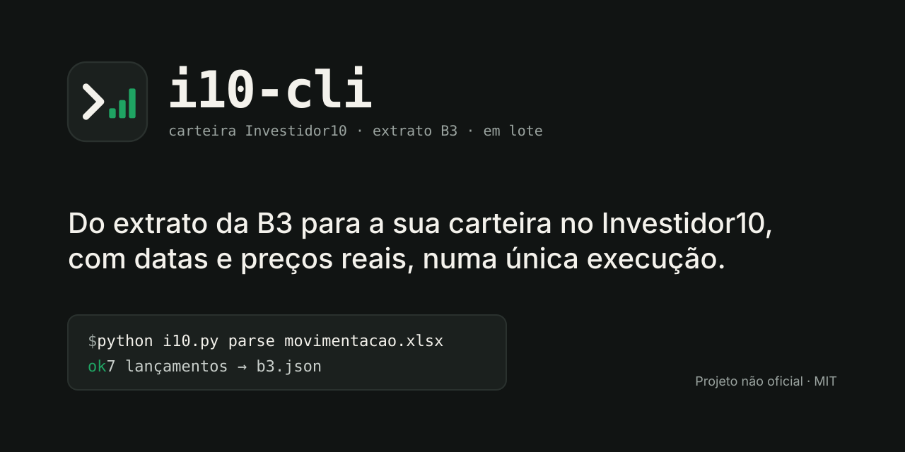

<p align="center">
  
</p>

<p align="center">
  <a href="LICENSE"></a>
  
  
  
</p>

<p align="center">
  <b>Lance compras de FIIs, ETFs, renda fixa e fundos na carteira do <a href="https://investidor10.com.br">Investidor10</a> em lote,<br>
  com as datas e preços reais do extrato gratuito da B3, sem precisar da integração paga.</b>
</p>

---

## Por quê

O gerenciador de carteira do Investidor10 é gratuito, mas importar o histórico automaticamente exige a
Integração B3, que só existe no plano PRO. Sem ela, cada compra precisa ser digitada à mão, com ativo,
data, quantidade e preço, um formulário por vez.

A **Área do Investidor da B3** já entrega esse histórico de graça, num Excel. O `i10-cli` faz a ponte:

1. lê o extrato da B3 (ou o relatório de produtos do Itaú, para renda fixa e fundos);
2. gera um JSON de lançamentos que você pode revisar e editar;
3. transforma esse JSON em um único script, que você roda na aba do Investidor10 em que já está logado.
   Todos os lançamentos são gravados de uma vez.

Ele nunca pede sua senha nem guarda cookies: quem autentica é a sessão do seu navegador.

## Recursos

- **Extrato de movimentação da B3**: as compras e vendas ("Transferência - Liquidação") viram lançamentos.
  A data de liquidação é convertida para o dia do pregão (D-2 úteis, pulando fins de semana e feriados da B3).
- **Relatório "meus produtos" do Itaú**: CDB, Cofrinhos e fundos de investimento pelo saldo atual.
- **Tipos suportados**: FIIs, ETFs, renda fixa pós-fixada (% do CDI) e fundos de investimento.
- **Cotação automática**: se o preço ficar `null`, usa a cotação que o próprio site sugere para a data.
- **Seguro contra ambiguidade**: se a busca de um fundo retorna mais de um resultado, nada é gravado e os
  candidatos voltam para você escolher.
- **Editar em vez de apagar**: um item com `"id"` corrige um lançamento existente.
- **`--dry-run`**: confere ativos, cotações e o payload exato antes de gravar.
- **Só biblioteca padrão**: um único arquivo Python, sem `pip install`.

## Instalação

```bash
git clone https://github.com/mcsscalabrin/i10-cli.git
cd i10-cli
python i10.py --help
```

Requer Python 3.9 ou superior. Nada mais.

## Início rápido

**1. Baixe o extrato na B3.** Na [Área do Investidor](https://www.investidor.b3.com.br/), vá em
**Extratos → Movimentação**, escolha um período que comece antes da sua primeira compra e exporte em Excel.

**2. Gere os lançamentos.** O id da carteira aparece na URL do Investidor10
(`investidor10.com.br/wallet/my-wallet/free/<id>`).

```bash
export I10_WALLET=1234567          # PowerShell: $env:I10_WALLET = "1234567"
python i10.py parse movimentacao-2026-10-28.xlsx -o lancamentos.json
```

**3. Revise** o `lancamentos.json`. É texto simples: ajuste, remova ou acrescente itens.

**4. Teste sem gravar e depois grave.**

```bash
python i10.py js lancamentos.json --dry-run -o dry.js
python i10.py js lancamentos.json -o run.js
```

**5. Rode o script** na aba da sua carteira no Investidor10: abra o DevTools (F12), vá em Console, cole o
conteúdo de `run.js` e pressione Enter. A resposta é um JSON curto, com um resultado por lançamento:

```json
[{"ok":"XPML11 3x105.2 2026-06-01"},{"ok":"BOVA11 2x128.4 2026-07-27"}]
```

**6. Confira** a carteira:

```bash
python i10.py positions     # gera o script que lista: tipo, ativo, quantidade, preço médio, total
```

> Também funciona com agentes que controlam o navegador (por exemplo, Claude in Chrome). O agente executa
> o script inteiro numa única chamada, em vez de preencher dezenas de formulários.

## Formato dos lançamentos

```json
{
  "wallet": 1234567,
  "entries": [
    {"kind": "ticker", "type": "Fii", "symbol": "XPML11", "qty": 3, "date": "2026-06-01", "price": 105.20},
    {"kind": "ticker", "type": "Etf", "symbol": "BOVA11", "qty": 2, "date": "2026-07-27", "price": null},
    {"kind": "fixed", "emitter": "Banco X", "title": "CDB", "indexer": "CDI", "pct": 102,
     "value": 1000.00, "date": "2026-08-10", "daily": true, "due": null},
    {"kind": "fund", "search": "GLOBAL DINAMICO RF LP", "pick": 12345, "value": 500.00, "date": "2026-09-01"}
  ]
}
```

| `kind` | Campos | Observações |
|---|---|---|
| `ticker` | `type` (`Fii`, `Etf`), `symbol`, `qty`, `date`, `price` | `price: null` usa a cotação do site. `"side": "SELL"` lança venda. `"id"` edita um lançamento existente. |
| `fixed` | `emitter`, `title` (`CDB`, `LCI`…), `indexer`, `pct`, `value`, `date`, `daily`, `due` | Pós-fixado. `due: null` com `daily: true` = sem vencimento. |
| `fund` | `search`, `value`, `date`, `pick` (opcional) | `pick` é o id ou um trecho do nome do fundo, para resolver ambiguidades. |

Há um exemplo completo em [`examples/lancamentos.exemplo.json`](examples/lancamentos.exemplo.json).

## Comandos

| Comando | O que faz |
|---|---|
| `parse <arquivos…> [-o arq]` | Extrato de movimentação da B3 e/ou relatório Itaú → JSON de lançamentos |
| `js <arq> [--dry-run] [-o arq]` | JSON → script que grava (ou só simula) os lançamentos |
| `search <tipo> <termo>` | Script que busca ativos (`Fund`, `Fii`, `Etf`) |
| `quote <tipo> <id> [data]` | Script que consulta a cotação sugerida numa data |
| `positions [tipos…]` | Script que lista as posições da carteira |
| `entries [grupos…]` | Script que lista os lançamentos com id (para editar) |

## Como funciona

```text
 Extrato B3 (.xlsx) ─┐
                     ├─► i10 parse ─► lancamentos.json ─► i10 js ─► run.js
 Relatório Itaú ─────┘                (você revisa)                    │
                                                                       ▼
                                  aba logada do Investidor10 ── fetch ──► API interna da carteira
                                                                       │
                                                                       ▼
                                                     [{"ok": …}, {"erro": …, "candidatos": […]}]
```

O script usa os mesmos endpoints que o formulário "Adicionar Lançamento" do site chama
(`search-ticker`, `quotation`, `entry/store`, `entry/update`, `entries`, `summary/actives`), com a sua
própria sessão. Nenhum dado sai do seu computador para terceiros.

## Privacidade

- Extratos e JSONs com as suas posições estão no `.gitignore`. Não faça commit deles.
- O script gerado contém só os lançamentos do seu JSON. Leia-o antes de colar no console:
  é uma boa prática com qualquer código que você executa no navegador.

## Limitações

- **API não documentada.** Os endpoints foram observados no próprio site e podem mudar sem aviso.
- **Testado com** FIIs, ETFs, CDB pós-fixado e fundos de investimento. Ações, BDRs, vendas, renda fixa
  prefixada e Tesouro Direto ainda não foram validados. Pull requests são bem-vindos.
- **Feriados móveis** (Carnaval, Sexta-feira Santa, Corpus Christi) estão cadastrados só para 2026 e 2027.
  Para compras em outros anos perto dessas datas, confira o dia do pregão.
- **Renda fixa e fundos do Itaú** entram pelo saldo atual, porque o extrato de movimentação da B3 não traz
  essas aplicações.
- **Rodar o mesmo JSON duas vezes duplica os lançamentos.** Use `entries` para conferir antes.

## Aviso legal

Projeto independente e **não oficial**, sem qualquer vínculo com Investidor10, B3 ou Itaú Unibanco.
Use por sua conta e risco, respeitando os termos de uso de cada serviço. Não é recomendação de investimento.

## Contribuindo

Issues e pull requests são bem-vindos, principalmente para:

- novos formatos de extrato (outras corretoras, notas de corretagem);
- novos tipos de ativo (ações, BDRs, Tesouro Direto);
- calendário de feriados da B3 para outros anos.

## Licença

[MIT](LICENSE)
